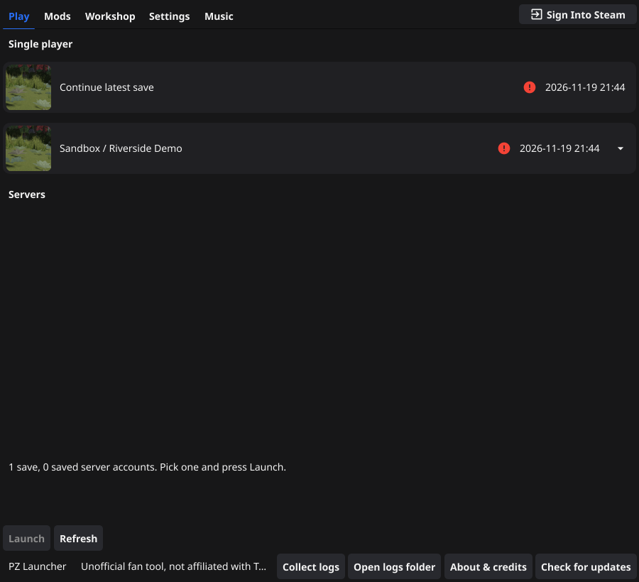
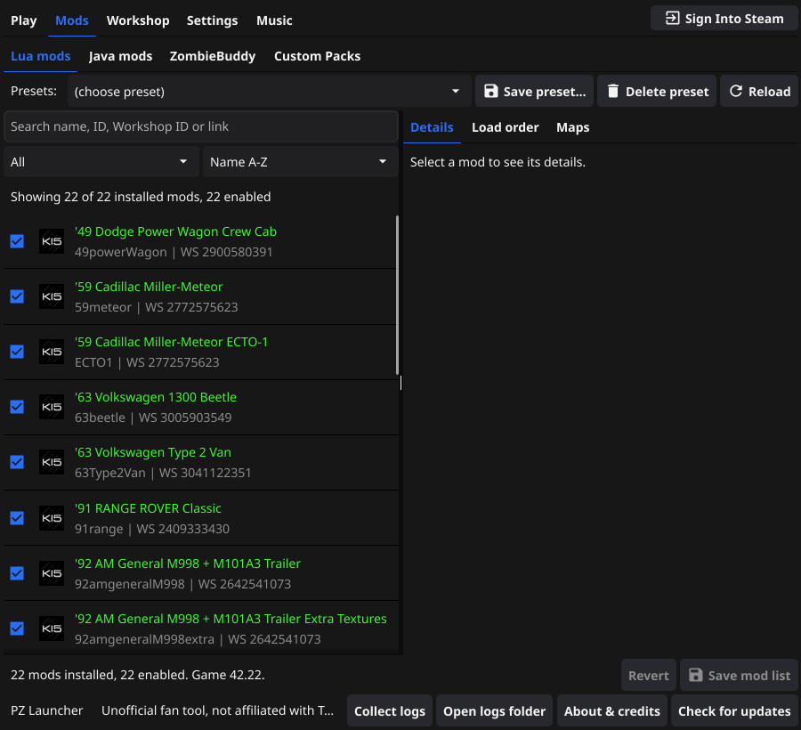
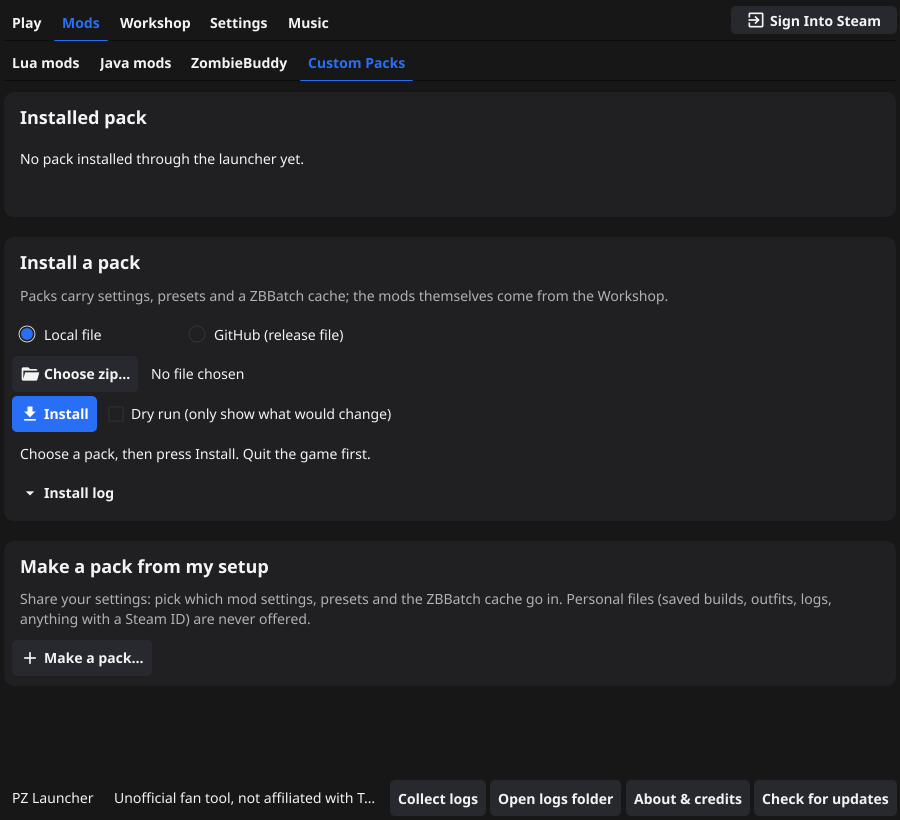
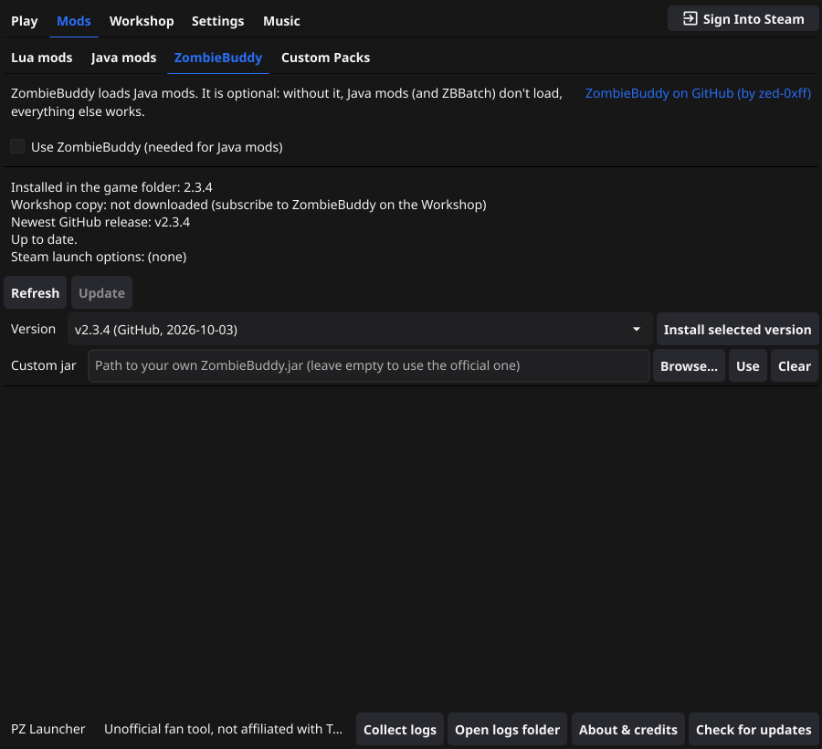
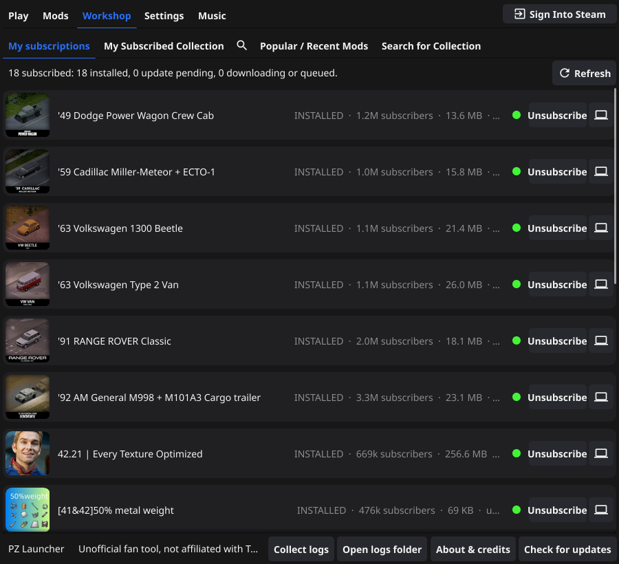
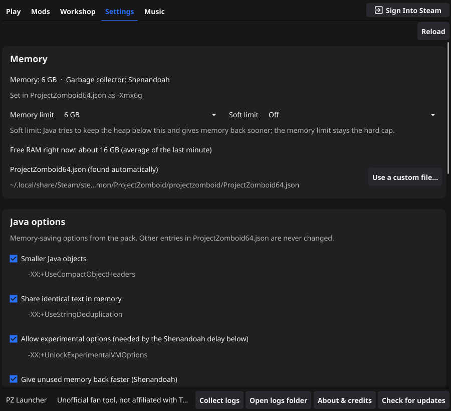
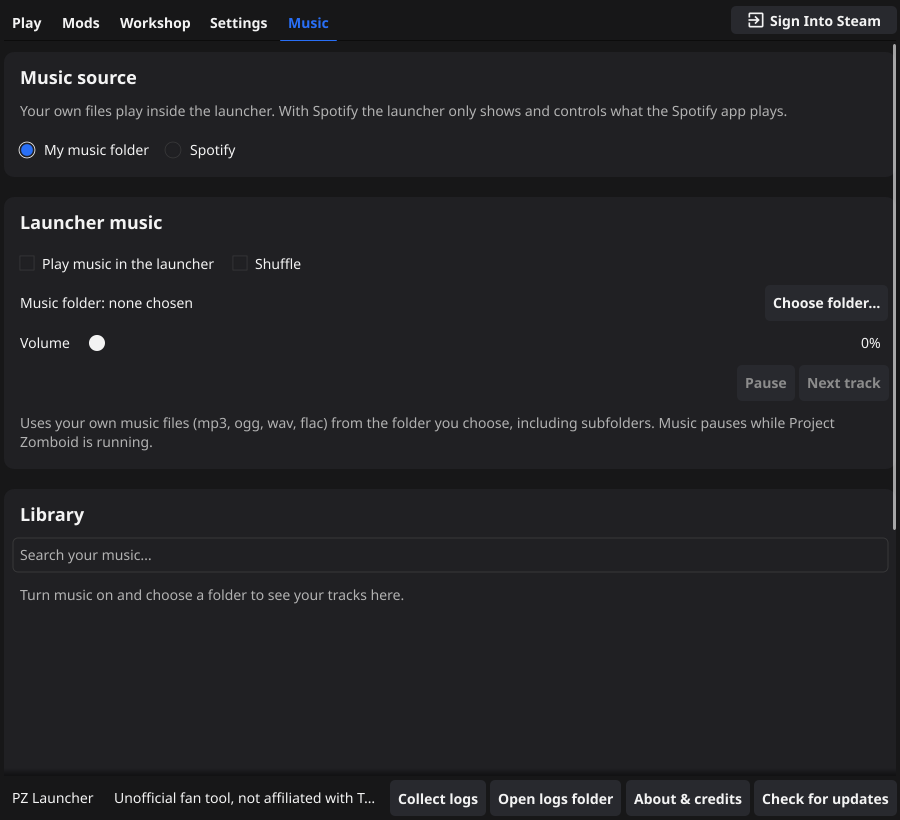

<p align="center"></p>

# PZ Launcher

A launcher for Project Zomboid (Build 42): play your saves and servers, manage Lua and Java mods, browse the Workshop, install and share setting packs, and play music while you get ready.

Unofficial fan tool; not affiliated with The Indie Stone.



## Download

Get the latest release from the [Releases page](https://github.com/katachinosekai/pzlauncher/releases/latest):

- **Windows:** `PZLauncher-windows-amd64.exe`
- **Linux:** `PZLauncher-linux-x86_64.AppImage` (`chmod +x` it first)

The launcher updates itself: press **Check for updates** at the bottom. Updates are signed; the launcher refuses a release that isn't.

## Features

### Play
Your single-player saves and saved servers, with checks before launch (game version, missing or outdated mods, server online, version and players). Launch straight into a save or onto a server.

### Mods
| | |
|---|---|
|  |  |

- **Lua mods:** your mod list like the game's own, with load order, maps and saved presets. **Mod settings** opens the settings files that belong to a mod (found automatically) in an editor laid out like the game's option screens; the old file is backed up before saving.
- **Java mods:** the ZombieBuddy approvals for every installed Java mod, refreshed automatically, with the same Mod settings button.
- **ZombieBuddy:** switch it on or off, update it, pick a version, or use your own jar (with a warning). Link to [ZombieBuddy on GitHub](https://github.com/zed-0xff/ZombieBuddy).
- **Custom Packs:** install a pack from a local zip or from a GitHub release (`owner/repo` or a release link). Make a pack from your own setup: pick which mod settings, your mod list, world presets and the ZBBatch cache go in. Personal files (saved builds and outfits, logs, anything with a Steam ID) are never offered.



### Workshop


My subscriptions, your subscribed collection (with subscribe-to-missing), search, Popular / Recent mods (with Sort by) and a collection browser. Results load as you scroll. **Sign Into Steam** (top right) lets the launcher subscribe and unsubscribe in the background; you sign in on Steam's own page, the launcher never sees your password.

### Settings


Memory limit and soft limit, memory-saving Java options, display and game options, with the game's `ProjectZomboid64.json` found automatically (or a custom file).

### Music


Play your own music folder or follow Spotify (the Spotify app must be running). Browse and search your tracks, switch the game's own music on or off, and open Knox Inventory's music folder when Knox is installed. While something plays, a small player with the scrolling title fades in next to the Steam button.

### Bottom bar
**Collect logs** (every game, crash and launcher log in one zip, with Steam IDs, passwords and your user folder name removed), **Open logs folder**, **About & credits**, **Check for updates**.

## Privacy and security

- Steam sign-in happens on Steam's own page in a built-in browser limited to Steam's sites; the launcher never handles your password.
- Releases and self-updates are signed (ed25519); unsigned or changed releases are refused.
- Packs from GitHub ask before installing; pre-approving Java mods in ZombieBuddy asks first.
- Installing and changing Steam launch options are blocked when the launcher runs as administrator or root.

## Build

Requires Go and the Fyne build dependencies.

```sh
go build -tags wayland ./cmd/pzlauncher   # or without the tag on X11
```

Release builds: `scripts/release.sh <version>` (uses [fyne-cross](https://github.com/fyne-io/fyne-cross), appimagetool and the release signing key).

## Credits

Project Zomboid is made by The Indie Stone. ZombieBuddy is by zed-0xff. Mods belong to their authors. The raccoon icon is original artwork for this project (`assets/icon.svg`).

## License

MIT
